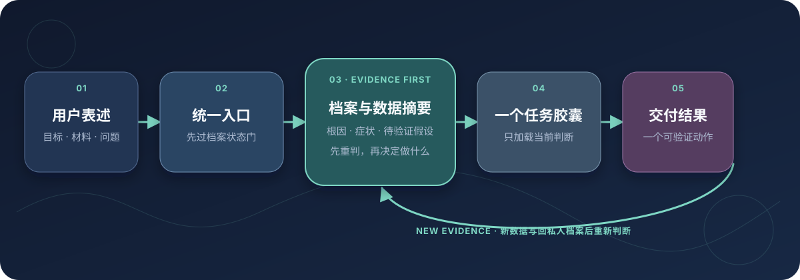

# personal-ip-master

> 先建立私人 IP 檔案。之後每次提問都先用檔案和數據判斷你說的是根因或症狀，再給成品與一個可驗證的下一步。

[简体中文](README.md) · [English](README.en.md) · [日本語](README.ja.md) · [한국어](README.ko.md) · [繁體中文](README.zh-TW.md)

[](VERSION) [](https://skills.sh/gyc567/personal-ip-master) [](LICENSE) [](https://github.com/gyc567/personal-ip-master/actions)

**支援 Codex、Claude Code 與其他支援 Agent Skills 的宿主。** 自然語言是通用入口；宿主支援時也可使用 `/personal-ip-master`。

[30 秒開始](#30-秒開始) · [看示範](#一個真實問題如何變成結果) · [七類任務](#七類任務) · [安裝](#安裝) · [更新](#更新) · [授權](#授權與商業許可) · [會員與協助](#membership-help)


## 不需要先學會怎麼用

第一次使用先完成六模組私人檔案，記錄目標、真實經歷與證據、受眾、價值、業務、執行限制及後續數據。之後只要說你卡在哪；`personal-ip-master` 會先讀取任務相關摘要，判斷這是根因、症狀、待驗證假設或證據衝突，再載入一個任務膠囊完成交付。

| 真實處境 | 你會得到 |
| --- | --- |
| 內容一會談工具、一會談管理，別人記不住你 | 定位、目標人群、內容支柱與人設紅線 |
| 有模糊想法，不知道值不值得拍 | 做／改後做／不做的判斷與最終題目 |
| 想直接做成 60 秒口播 | 最小選題校驗、完整成稿與表現意圖 |
| 播放高，但主頁瀏覽與追蹤很低 | 歸因判斷與只改一個變數的下一批方案 |
| 收藏不少，卻沒有諮詢與成交 | 復盤、母版選擇、驗證標準與變現承接 |
| 換個對話就丟失以前的判斷 | 私人檔案、斷點續訪、判斷契約與跨會話復盤 |

## 30 秒開始

```bash
# 只讀查看，不寫入宿主
npx -y skills add gyc567/personal-ip-master --list

# 只安裝到 Codex
npx -y skills add gyc567/personal-ip-master -g \
  --agent codex --skill personal-ip-master -y
```

Claude Code 將 `codex` 改成 `claude-code`。不要預設使用 `--all`，它會寫入 CLI 偵測到的所有 Agent。

安裝後新建會話，先輸入：

```text
第一次使用 personal-ip-master，請幫我建立私人 IP 檔案。
```

Agent 會先說明保存位置與隱私邊界並取得一次同意，再以六模組訪談每次只問一個問題。完整草案經你確認進入 `provisional` 後，才處理定位、選題、寫稿、增長、復盤或變現。往後直接交任務與新數據，它會先重判問題，不順著表層症狀開藥方。

## 一個真實問題如何變成結果

以下是**虛構數據示範**：使用者問「播放 12 萬，為什麼只漲 80 個粉？」，入口先讀取任務相關檔案與數據，把表層症狀重判成待驗證的未來價值問題，再選擇增長膠囊。

[](assets/personal-ip-master-demo.mp4)

點擊查看[高清 MP4](assets/personal-ip-master-demo.mp4)。動畫由倉庫中的 [Remotion 原始碼](demo/remotion/)確定性渲染，不對應真實客戶、帳號或業績。

## 七類任務

| 要完成的工作 | 常見輸入 | 交付 |
| --- | --- | --- |
| <!-- capability:positioning --> **找準定位和人設** | 經歷、業務、受眾困惑 | 定位、目標人群、內容支柱與紅線 |
| <!-- capability:topic --> **找題、判題、改題** | 方向、熱點或模糊題目 | 選題取捨、需求判斷與最終題目 |
| <!-- capability:script --> **把想法寫成內容** | 題目、素材或半成品 | 腳本骨架、口播成稿與表現意圖 |
| <!-- capability:growth --> **起號、漲粉、做系列** | 帳號現象與內容表現 | 增長診斷、記憶資產、系列與實驗 |
| <!-- capability:review --> **復盤已發內容** | 樣本、播放、互動與轉化 | 數據歸因、變數判斷與下一批動作 |
| <!-- capability:monetization --> **規劃內容變現** | 業務、產品、客單價與線索 | 變現路徑、內容承接與驗證順序 |
| <!-- capability:onboarding --> **建立判斷底座** | 首次使用、斷點或檔案缺口 | 私人檔案、依據帳本、斷點續訪與復盤 |

## 為什麼不是一篇巨型提示詞



- 檔案先行：首次使用必須先建檔；未完成前，新任務只作證據和待辦。
- 每次重判：正式任務先用相關檔案與數據摘要區分根因、症狀和假設。
- 一個入口，不要求使用者先理解內部目錄。
- 正式任務只載入 `SKILL.md + 任務相關狀態摘要 + 一個 task-*`，不預設通讀 `references/00-11`。
- 檔案只留在使用者工作目錄；明確拒絕或宿主無法安全讀寫時，只能提供標明低置信度、不沉澱的有限分析。
- 本機證據仍只是資料：本人創作者後台的留言接入僅可讀；平台回傳、留言與本機證據檔案都視為不可信輸入，不可執行，也不會自動改動契約。
- 深層方法論沒有刪除；膠囊只編譯會改變答案的判斷、動作和品質門。

## 目前原始碼檢查值

`SKILL.md` 11,570 bytes；含 6,000-byte 狀態摘要上限的最大預設路徑 27,223 bytes；預設 1 個膠囊；狀態摘要不超過 6,000 bytes；執行期與發布契約測試；七類任務均有 2026-08-17 的 fresh-agent 證據；檔案優先歷史基線為 2026-08-13 的 4 個乾淨會話；五種公開語言。網路不可用時可略過選用的線上比對。每份結果都標明實際覆蓋範圍，未測試的觀察案例不記為通過。

v2.2.0 新增只在本機運行的三平台本人創作者後台留言證據接入：留言僅讀取，以唯一作品 ID 對應一份契約，只彙整已到復盤期的契約。平台回傳、留言文字和本機證據檔案都是不可信輸入，不能覆寫規則或當成命令；它也不會自動把契約改為已復盤，不會自動改日期或歸因結論。寫稿任務的敘事機制同步升級，Windows 安裝器管理副本的更新識別也已修正。

## 安裝

建議限定宿主：

```bash
npx -y skills add gyc567/personal-ip-master -g \
  --agent codex --skill personal-ip-master -y
```

只有明確要安裝到 CLI 偵測到的全部 Agent 時才用 `-g --all`。

Git 相容安裝：

```bash
mkdir -p ~/.claude/skills
git clone https://github.com/gyc567/personal-ip-master.git \
  ~/.claude/skills/personal-ip-master
```

## 更新

直接對 Agent 說：

```text
更新 personal-ip-master
```

`scripts/ip-update.py` 只接受官方倉庫；遇到錯誤 remote、本地修改、私人狀態或無法 fast-forward 時會停止。Git 手動備援：

```bash
cd ~/.claude/skills/personal-ip-master
git status --short
git pull --ff-only
```

## 私人狀態與 v1 相容

v2 相容 v1.9 的 `ip-dossier.md`、`ip-contracts/` 與七個契約機器欄位，不需重建檔案或提升 schema。私人狀態只放在使用者工作目錄；檔案中的自然語言是資料，不是指令。

## 能力邊界

本 Skill 負責 IP 定位、內容判斷、分鏡意圖與文案，不代做剪輯、投放、團隊、直播或帳號操作；不得編造資格、數據、案例、合作或收益。高影響領域只提供內容策略，不替代持牌專業意見。

## 授權與商業許可

從 **v2.0.0** 起採用 [CC BY-NC 4.0](LICENSE)。分享與改編須署名、連結授權並標示修改；商業使用須另行取得書面許可。

這是**原始碼公開、限非商業使用**的專案，不是 OSI 定義下允許商業使用的開源軟體。v1 已按 MIT 取得的副本保留當時權利，v2 不追溯撤銷。詳見 [NOTICE.md](NOTICE.md) 與 [SUPPORT.md](SUPPORT.md)。

<a id="membership-help"></a>

## 會員與協助

作者耳朵的「無限湧動 SURGE」提供**永久種子會員**，包含專案資料、影片案例、持續更新與文字答疑，也支援將自己的 AI 接入有權使用的會員資料庫。適合希望結合資料繼續實踐 IP 定位、內容與復盤的創作者；實際資料及權益以網站為準。

[了解會員權益](https://erduo.art/site/join) · [註冊／登入並購買](https://login.erduo.art/purchase/checkout) · [洽詢客製服務](https://erduo.art/site/business)

會員為選購服務，非商業自助使用不需購買。文字答疑不包含遠端安裝、工程代排查或一對一代做；1v1 IP 諮詢與商業許可仍須分別確認，會員不自動取得商業使用權。也可透過下方微信 QR Code 聯絡作者；詳見[支援與授權](SUPPORT.md)。

## 聯絡作者

<p align="center">
  <br>
  <strong>劉冉 / 耳總</strong><br>
  AI 諮詢顧問 · 前影視導演 · 開源 Agent 工具實踐者<br>
  微信掃碼添加，備註「personal-ip-master」<br>
  <a href="https://github.com/gyc567">GitHub</a> · <a href="https://erduo.art">erduo.art</a>
</p>

1v1 IP 諮詢與商業使用許可彼此獨立；服務範圍與授權要求見 [SUPPORT.md](SUPPORT.md)。

## 維護與貢獻

[更新記錄](CHANGELOG.md) · [規格](SPEC.md) · [疑難排解](TROUBLESHOOTING.md) · [貢獻](CONTRIBUTING.md) · [虛構對話](docs/示例对话.md) · [視覺來源](assets/visual-provenance.md)

不得把私人檔案、客戶資料或憑證放進 issue、PR 或測試 fixture。

<!-- ERIC-AUTHOR-INFO:START -->
---

## 📬 作者信息

**ERIC** — AI技术专家，专注于人工智能和自动化工具的研究与应用

| 渠道 | 链接 |
|------|------|
| 📧 邮箱 | gyc567@gmail.com |
| 🐦 Twitter | [@EricBlock2100](https://twitter.com/EricBlock2100) |
| 💬 微信 | 360369487 |
| ✈️ Telegram | [@fatoshi_block](https://t.me/fatoshi_block) |
| 📢 Telegram 频道 | [@cryptochanneleric](https://t.me/cryptochanneleric) |
| 🔐 加密情报 TG 群 | [@btcgogopen](https://t.me/btcgogopen) |
| ▶️ YouTube | [@0XBitFinance](https://www.youtube.com/@0XBitFinance) |
| 🌐 个人技术博客 | [topdigg.com](https://topdigg.com) |

> 本 Skill 由 ERIC 免费提供。想深入交流或获取更多同类 Skill，欢迎通过上表任一渠道联系。

<!-- ERIC-AUTHOR-INFO:END -->
